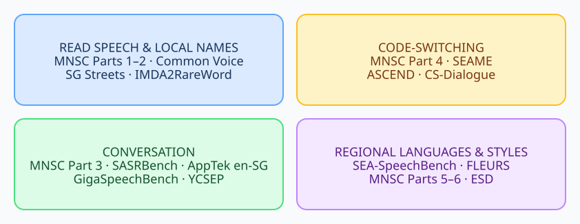
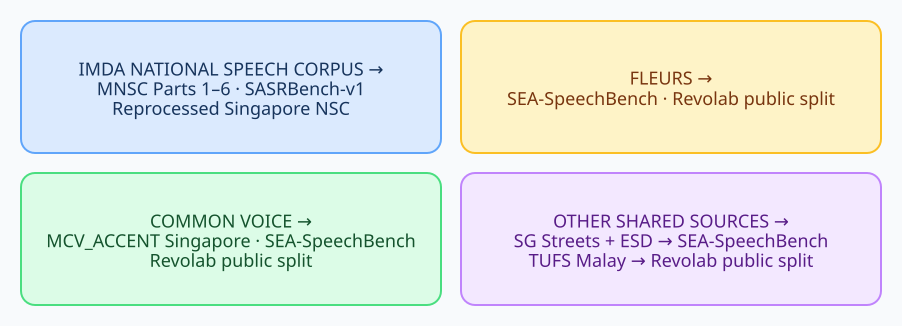

# Singapore and Southeast Asian speech recognition dataset survey

Which speech dataset should you use, and how much can you trust its reference text? This survey covers Singapore datasets and nearby regional collections. The [inventory](data/dataset-inventory.csv) links to all 34 screened entries.

[Choose a dataset](#choose-by-task-and-evidence) · [See examples](#what-the-data-looks-like) · [Singapore datasets](#singapore-datasets-with-usable-asr-references) · [MNSC parts](#all-six-mnsc-asr-tests) · [Regional datasets](#regional-and-code-switching-collections)

## Choose by task and evidence

Judge **transcript quality**, **fit to your speech setting**, **access terms**, and **independence of recordings** separately. A published transcript is not necessarily word-perfect.

| Need | Start with | Main caveat |
| --- | --- | --- |
| Conversational Singapore English | [AppTek en-SG](#singapore-datasets-with-usable-asr-references) | Manual transcripts, but only 10 speakers in role-played calls. |
| Colloquial Singlish | [MNSC Part 3](#all-six-mnsc-asr-tests) | Human-edited references; state how speaker labels and markup are scored. |
| Local names and brands | [MNSC Part 2](#all-six-mnsc-asr-tests) | Prompted reading, not conversation. |
| Code-switched Singapore speech | [MNSC Part 4](#all-six-mnsc-asr-tests) | Mixed scripts require an explicit scoring rule. |
| Singapore-accented web video | [GigaSpeechBench SGP-EN](#singapore-datasets-with-usable-asr-references) | Professional transcripts; audio-use rights are unclear. |
| Read Singapore-accented English | [Common Voice](#singapore-datasets-with-usable-asr-references) | Community validation; speaker balance varies by release. |

For conversational English, AppTek has public test files and stated terms; MNSC Part 3 better captures spontaneous Singlish. SASRBench and MNSC Part 3 both draw from NSC Part 3, so they are not independent confirmations. An “unseen” test also requires evidence about model training data.

**Use caution for WER:** YCSEP and some NAS search text are machine-generated; MERLIon CCS targets other tasks; ICE-SIN and several historical corpora lack an accessible aligned ASR test.

## Dataset map

Group datasets by speech setting; some span more than one branch.

The map shows content, not transcript reliability.

## What the data looks like

These published excerpts show reference formats, not model predictions or overall quality.

| Dataset and example | Reference excerpt | What to notice |
| --- | --- | --- |
| [MNSC Part 1](https://huggingface.co/datasets/MERaLiON/Multitask-National-Speech-Corpus-v1/viewer/ASR-PART1-Test/train) | “we watched the drama unfold before our eyes” | Read sentence; accent cannot be judged from text. |
| [SASRBench-v1](https://huggingface.co/datasets/mjwong/SASRBench-v1/viewer/default/test) | “I don't know [eh] I going to Korea [ah]” | Local particles; brackets affect scoring. |
| [AppTek en-SG](https://huggingface.co/datasets/apptek-com/apptek_callcenter_dialogues/blob/b98967d9946f7f59f58d08624a2a00fe98fe0219/test/en-SG/metadata.jsonl) | “Okay lah we shared that with farmers people.” | Service call; `lah` is part of the reference. |
| [ASCEND](https://huggingface.co/datasets/CAiRE/ASCEND/viewer/default/train) | “我刚刚开始record” | Mandarin–English mix in a Hong Kong training example. |

AppTek excerpt: `en_SG_Agriculture_1586768_channel1.wav`. Terms differ: AppTek and ASCEND state CC BY-SA 4.0; MNSC inherits Singapore Open Data Licence terms; SASRBench's MIT badge accompanies NSC-derived material.

## Shared sources and subsets

Branches show reused source material, not proven clip-level overlap.

The map is selective. Do not add parent and derived hours or assume two releases have independent recordings.

## Singapore datasets with usable ASR references

| Dataset | Speech and size | Access and interpretation |
| --- | --- | --- |
| [AppTek Call-Center Dialogues en-SG](https://huggingface.co/datasets/apptek-com/apptek_callcenter_dialogues) | 57 role-played calls, 10 speakers, two channels per call; 8.1 annotated hours. | Public test, manual verbatim text, CC BY-SA 4.0. Paired channels share calls. The [scorer](https://huggingface.co/datasets/apptek-com/apptek_callcenter_dialogues/blob/b98967d9946f7f59f58d08624a2a00fe98fe0219/score.py) omits unmatched files; its [normalizer](https://huggingface.co/datasets/apptek-com/apptek_callcenter_dialogues/blob/b98967d9946f7f59f58d08624a2a00fe98fe0219/word_mappings.py) removes `lah` and `ah`. |
| [GigaSpeechBench SGP-EN](https://github.com/SpeechColab/GigaSpeechBench) | Singapore-accented web video; 45 parent recordings, 9,480 raw segments, 10.75 segment hours. | [Paper](https://arxiv.org/html/2606.28884v3) reports professional transcription. Audio rights are unstated; accent tags do not prove nationality. Scored subsets exclude some raw segments. |
| [SASRBench-v1](https://huggingface.co/datasets/mjwong/SASRBench-v1) | 3,747 Singlish test clips, each 10+ words and ≤20 seconds. | NSC Part 3 derivative; exact overlap with MNSC Part 3 is unknown. |
| [SG Streets](https://github.com/khassanoff/SG_streets) | Street-name reading; [SEA-SpeechBench](https://huggingface.co/datasets/MERaLiON/sea_audiobench_datasets_ASR) uses 492 examples (~0.7 h). | Upstream work describes six sessions, not six speakers; audio terms are unspecified in the aggregate. |
| [Common Voice English, Singapore accent](https://commonvoice.mozilla.org/en/datasets) | Scripted reading; [CV26 metadata](https://github.com/common-voice/cv-dataset/blob/main/datasets/scripted-speech/cv-corpus-26.0-2026-06-12.json) counts 4,722 clips across splits. | Current Singapore test count is unclear. A separate [accent test](https://aclanthology.org/2023.emnlp-main.444.pdf) has 477 clips (small) or 2,967 (full); the small set is nested and speaker-concentrated. [Terms](https://community.mozilladatacollective.com/faq-why-cant-i-re-host-or-share-common-voice-datasets-that-i-download-from-mdc/) restrict mirroring. |
| [IMDA2RareWordDataset](https://github.com/cyaaronk/IMDA2RareWordDataset) | NSC-derived road-name and address test manifests. | WAV files require separate NSC access; overlap with MNSC Part 2 or SG Streets is unknown. |

## All six MNSC ASR tests

The [MNSC paper](https://arxiv.org/html/2501.01034v2) and [release](https://huggingface.co/datasets/MERaLiON/Multitask-National-Speech-Corpus-v1) define six ASR tests (10,000 examples total). Parts 1–2 are sentence level; Parts 3–6 are dialogue level. Each test configuration uses a Hugging Face split named `train`. The paper's Part 1–2 duration cells are malformed, so no hours are shown here.

| Part | Test examples | Speech setting |
| --- | ---: | --- |
| 1 | 3,000 | Phonetically balanced read English |
| 2 | 3,000 | Prompted Singapore names, food, places, and brands |
| 3 | 1,000; about 7.7 h | Spontaneous daily-life conversation |
| 4 | 1,000; about 7.3 h | English conversation with Mandarin, Malay, or Tamil code-switching |
| 5 | 1,000; about 6.9 h | Debate, finance, and emotional speaking styles |
| 6 | 1,000; about 6.8 h | Travel, restaurant, banking, insurance, and public-service scenarios |

MNSC also includes question answering, summarization, and paralinguistic tasks; these are not extra ASR tests. The [underlying NSC](https://www.imda.gov.sg/how-we-can-help/national-speech-corpus) has separate registration and attribution requirements.

## Other Singapore sources

| Source | What it adds | Availability caveat |
| --- | --- | --- |
| [MERLIon CCS](https://github.com/MERLIon-Challenge/merlion-ccs-2023) | 30+ hours, 300 English–Mandarin child-directed recordings ([paper](https://www.isca-archive.org/interspeech_2023/chua23_interspeech.pdf)). | Primarily language ID and diarization; check lexical references and terms. |
| [NIECSSE](https://videoweb.nie.edu.sg/phonetic/niecsse/index.htm) | Interviews with 46 Singapore and five British speakers. | Research acknowledgement required; no aligned ASR test stated. |
| [Lim Siew Hwee corpus](https://videoweb.nie.edu.sg/phonetic/lim-siew-hwee-corpus/index.htm) | Three informal friend conversations. | Small qualitative set; focal speakers also appear in NIECSSE. |
| [YCSEP podcasts](https://huggingface.co/datasets/stcoats/YCSEP_v1) | Natural Singapore podcast speech. | Uncorrected WhisperX text; MIT badge conflicts with noncommercial-use prose. |
| [ICE-SIN](https://www.ice-corpora.uzh.ch/en/access.htm) / [GSSEC](https://www3.ntu.edu.sg/home/yytan/interspeech.pdf) | Historical English; ~8 hours of GSSEC conversation feed ICE-SIN. | ICE-SIN's million words include writing; aligned ASR access is unclear. |
| [CALL](https://www.researchgate.net/publication/228449974_The_development_of_a_Singapore_English_call_resource), [NESSI](https://uclouvain.be/en/research-institutes/ilc/cecl/nessi.html), [NAS](https://www.nas.gov.sg/archivesonline/oral_history_interviews/) | Pronunciation learning, student interviews, oral history. | Ready ASR references and rights vary; some NAS search text is automated. |

## Regional and code-switching collections

| Source | Scope | Interpretation |
| --- | --- | --- |
| [SEA-SpeechBench ASR](https://huggingface.co/datasets/MERaLiON/sea_audiobench_datasets_ASR) | 26,863 examples, ~52.9 h, 11 languages, 33 configurations. | Aggregate of upstream sources with different terms; evaluation configurations use `train`. Includes SgpCCSC Mandarin and Thai elderly speech. |
| [SEAME](https://catalog.ldc.upenn.edu/LDC2015S04) | ~192 h of Singapore/Malaysia Mandarin–English conversation. | LDC agreement; transcript versions differ. 192 h is the full release, not its test set. |
| [ASCEND](https://huggingface.co/datasets/CAiRE/ASCEND) | Hong Kong Mandarin–English conversation; 10.62 h overall, 1,315 test utterances. | CC BY-SA 4.0; outside Singapore. |
| [CS-Dialogue](https://huggingface.co/datasets/BAAI/CS-Dialogue) | Mainland Chinese Mandarin–English dialogue. | Paper says 6,293 test utterances; pinned manifests show 6,257. CC BY-NC-SA 4.0; mixed error rate counts characters and words. |
| [Singapore code-switch ASR tests](https://www.isca-archive.org/interspeech_2025/nguyen25_interspeech.pdf) | Malay–English (11.61 h), Mandarin–Malay (7.46 h), Tamil–English (13.73 h). | By request; spoken generated dialogue or assembled sentences, not spontaneous code-switching. |
| [Revolab Malaysian public split](https://huggingface.co/datasets/Revolab/ASR-Benchmark-Public) | 820 Malay/English clips (~2.2 h), human-verified text. | Contains TTS, singing, telephony, FLEURS, Common Voice, and TUFS material. Annotation CC BY 4.0 does not settle source-audio rights. |
| [FLEURS](https://huggingface.co/datasets/google/fleurs) | Multilingual read speech with train/development/test splits. | CC BY 4.0; reading is unlike conversation. |

SEA-SpeechBench's [source list](https://huggingface.co/datasets/MERaLiON/sea_audiobench_datasets_ASR#source-data) includes Bloom-Speech, MIG, Bud500, VietMed, Common Voice, ESD, MalCSC, SMalDuSC, OpenSLR, SFDuSC, LOTUS, and Thai Elderly Speech. [SEACrowd](https://github.com/SEACrowd/seacrowd-datahub) aids discovery; source terms still apply.

## Other related releases

| Release | Relationship to the datasets above |
| --- | --- |
| [Reprocessed Singapore NSC](https://huggingface.co/datasets/recursal/reprocessed_singapore_national_speech_corpus) | New packaging of NSC, not new recordings; check transformations and splits. |
| [MCV_ACCENT Singapore test](https://github.com/csalt-research/accented-codebooks-asr) | Common Voice accent test; its small split is nested in the full split. |
| [AudioBench Singapore evaluations](https://github.com/AudioLLMs/AudioBench/blob/main/src/dataset.py) | Singapore-content and Singlish-emotion sets have private audio and references. |
| [EdAcc](https://www.research.ed.ac.uk/en/datasets/the-edinburgh-international-accents-of-english-corpus/) | ~40 h of English accents; broader than Singapore. |
| [Emotional Speech Dataset](https://github.com/HLTSingapore/Emotional-Speech-Data) | English/Mandarin emotional reading in SEA-SpeechBench; research-use form conflicts with an MIT badge, and speaker origin is unclear. |

## Reading the counts

Hours may describe a full corpus, a filtered test, or reused material. Counts and licence notes come from publishers; they do not certify each clip or prove that test sets are independent.
